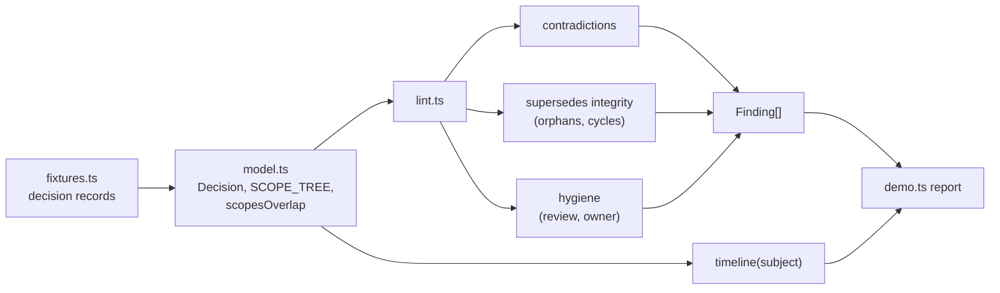

# adrlint

A decision-record linter that finds two live decisions contradicting each other, not two missing template fields.

[](https://github.com/SlateGitOrg/adrlint/actions/workflows/ci.yml)

## Why

Decision records accumulate for years. ADR-014 says the organisation standardises on PostgreSQL. ADR-061 says new payment services use DynamoDB, and never marks ADR-014 superseded. New joiners find both, pick one each, and the estate fragments along the seam. Template linters check that fields are filled in; they cannot see that two accepted decisions disagree.

adrlint treats the records as a graph. It flags a decision whose subject and scope overlap an earlier *active* decision with no explicit supersedes edge, and just as importantly it stays quiet about pairs that were already resolved or that govern genuinely different scopes.

## Features

- Typed decision model: status, date, owner, subject, scope, supersedes, relates-to, review date.
- Scope hierarchy: a parent scope governs its children (`all-services` contains `payments`), so overlap is not a literal string match.
- `UNRESOLVED_CONTRADICTION`: two accepted decisions, same subject, overlapping scope, no supersedes edge between them.
- Supersedes integrity: dangling references, cycles, an accepted decision that still has an accepted predecessor, and records marked superseded that nothing supersedes.
- Hygiene: overdue review dates and ownerless decisions on accepted records.
- Per-subject timeline showing every decision on a subject and how many are simultaneously active.

## Architecture



`model.ts` defines the decision type and expands scopes through `SCOPE_TREE`. `lint.ts` runs three independent rule groups over the full set and concatenates their findings; errors (contradictions, broken supersedes edges) are separated from warnings (hygiene). TypeScript runs natively through Node's type stripping, so there is no build step.

## Quick start

Prerequisites: Node.js 22.18 or newer (CI uses 24). No dependencies and no `npm install`.

```bash
git clone https://github.com/SlateGitOrg/adrlint.git
cd adrlint
npm test        # 21 tests
npm run demo    # lint the sample decision log and print a report
```

## Example

`npm run demo` lints ten sample records and prints (trimmed):

```text
  10 decision records spanning three years.
  3 error(s), 4 warning(s).

    [UNRESOLVED_CONTRADICTION]
      ADR-061 ("New services default to DynamoDB") and ADR-014 ("Standardise on PostgreSQL") are both accepted, both govern primary-datastore, and their scopes overlap - but ADR-061 does not supersede ADR-014
    [ORPHAN_SUPERSEDES]
      ADR-058 supersedes ADR-999, which does not exist

  WHAT IT DELIBERATELY DOES NOT FLAG
    ADR-022 / ADR-048  -  already resolved by an explicit supersedes edge
    ADR-035 / ADR-036  -  same subject, disjoint scope (batch vs payments)

    2023-04-11  ACTIVE    ADR-014  Standardise on PostgreSQL
    2025-02-03  ACTIVE    ADR-061  New services default to DynamoDB
    2 decisions are simultaneously ACTIVE on this subject: ADR-014, ADR-061
```

To lint your own records, build `Decision[]` objects and call `lint(decisions, { today })` from `src/lint.ts`.

## How it works

- **Scope overlap.** Both scope sets are expanded to all descendants in `SCOPE_TREE`, then intersected. A literal intersection would miss `all-services` versus `payments`, which share no string but clearly overlap.
- **Contradiction check.** Pairwise over accepted decisions: same subject, overlapping scopes, and neither supersedes the other. The older and newer record are named in the message.
- **Cycle detection.** Depth-first walk over supersedes edges with a visiting set, so a cycle is reported instead of looping.
- **False positives are the design constraint.** The fixtures include a correctly superseded pair and a same-subject pair with disjoint scopes; tests assert these are never flagged.

## Testing

```bash
npm test
```

21 tests with Node's built-in runner cover: all planted contradictions found and nothing extra, correctly superseded and disjoint-scope pairs not flagged, scope overlap (parent/child, siblings, symmetry, deep nesting), supersedes integrity including cycles, hygiene warnings, timeline output, and a clean log producing no findings.

## Project layout

```text
src/model.ts       Decision type, scope tree, scope overlap
src/lint.ts        Rules, findings, timeline
src/fixtures.ts    Sample decision log with planted ground truth
src/demo.ts        Report over the sample log
tests/lint.test.ts
docs/ARCHITECTURE.md
```

## Limitations

- Subjects and scopes are explicit fields; adrlint does not infer them from prose.
- The scope tree is a static table in `model.ts`, and there is no file or front-matter parser or CLI yet.
- Contradiction checking is pairwise, so it is quadratic in the number of accepted decisions.

## License

MIT — see [LICENSE](LICENSE).
