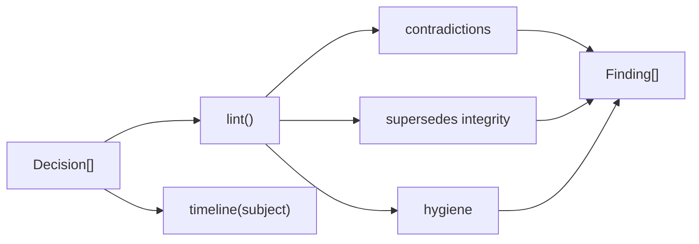

# Architecture

## Context

Architecture decision records pile up over years. Teams record decisions but rarely check them against each other, so two accepted records can quietly disagree. adrlint models records as a graph and reports those disagreements, along with broken supersedes chains and stale reviews.

## Container view

Everything is pure functions over an in-memory `Decision[]`; there is no I/O, state or build step.

## Key decisions

**Scope hierarchy instead of string matching.** Scopes are expanded through `SCOPE_TREE` before intersection. Trade-off: the tree is static and must be kept in step with the organisation; in return `all-services` correctly overlaps `payments`.

**Only accepted decisions can contradict.** Proposed, rejected and superseded records are ignored by the contradiction rule, which keeps noise low. Trade-off: two conflicting proposals are not reported until one is accepted.

**An explicit supersedes edge resolves a pair, in either direction.** Pairs linked by supersedes are never flagged as contradictions; a separate rule reports the case where the superseded record is still marked accepted.

**Errors versus warnings.** Contradictions and broken supersedes edges are errors. Overdue reviews and missing owners are warnings.

## Failure modes

- A supersedes edge to a missing record is reported as `ORPHAN_SUPERSEDES`.
- Supersedes cycles are detected with a visiting set and reported, never followed forever.
- A scope missing from `SCOPE_TREE` is treated as a leaf that overlaps only itself.

## Out of scope

Parsing Markdown or front matter, inferring subjects from prose, and rewriting records.
